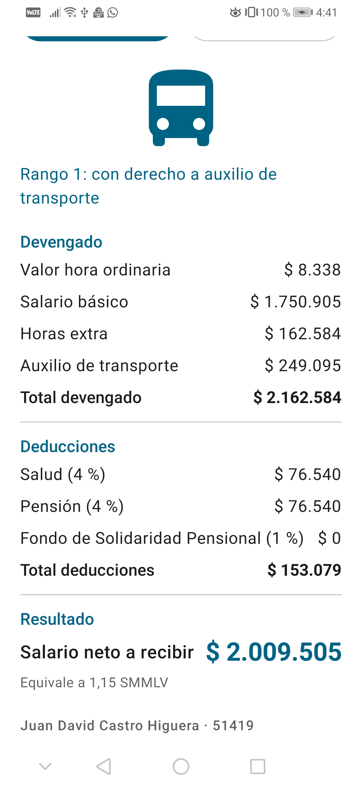
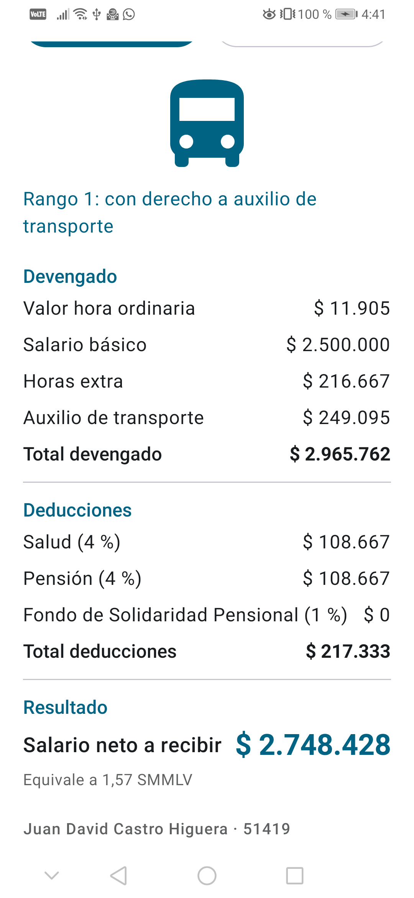
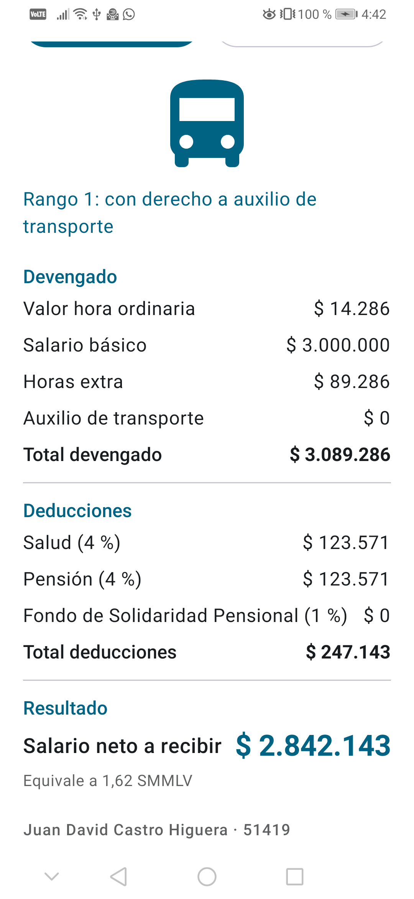
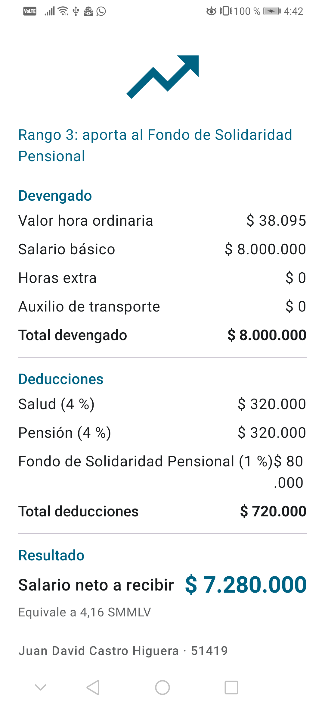

# Calculadora de Nómina – Colombian Payroll Calculator

**Estudiante:** Juan David Castro Higuera
**Código:** 51419

Aplicación Android (Jetpack Compose) que permite a un trabajador colombiano estimar el pago
mensual que recibirá. A partir del salario básico y de las horas extra trabajadas en el mes,
calcula el valor de las horas extra, determina si hay derecho al auxilio de transporte, aplica
las deducciones de ley y muestra el salario neto a recibir con el desglose de cada concepto.

> **Nota académica:** el modelo de cálculo es simplificado y está basado en la normativa
> vigente en septiembre de 2026. No incluye retención en la fuente, recargos nocturnos
> ordinarios ni prestaciones sociales. No reemplaza la liquidación de nómina realizada por un
> empleador ni la asesoría de un profesional contable o laboral.

---

## Funcionalidades implementadas

| ID  | Funcionalidad | Elemento técnico |
|-----|---------------|------------------|
| F1  | Campo de salario básico con teclado numérico y acción "Siguiente" | `OutlinedTextField`, `KeyboardOptions`, `ImeAction.Next` |
| F2  | Campo de horas extra diurnas (vacío = 0) | `OutlinedTextField`, `ImeAction.Next` |
| F3  | Campo de horas extra nocturnas con acción "Listo" | `OutlinedTextField`, `ImeAction.Done` |
| F4  | Interruptor de horas extra en domingo o festivo | `Switch` + estado `Boolean` |
| F5  | Interruptor de transporte suministrado por la empresa | `Switch` + estado `Boolean` |
| F6  | Botón "Calcular" con la lógica fuera de la interfaz | `Button.onClick`, `calcularNomina()` en archivo aparte |
| F7  | Desglose completo (devengado, deducciones y neto) | `Text`, `Row`, `Column`, estado `ResultadoNomina?` |
| F8  | Formato de moneda colombiana sin decimales | `NumberFormat.getCurrencyInstance(Locale.forLanguageTag("es-CO"))` |
| F9  | Imagen distinta según el rango salarial | `Image`, `enum RangoSalarial`, expresión `when` |
| F10 | Validaciones con mensajes y `isError` | `toDoubleOrNull()`, operador Elvis, estado de error |
| F11 | Botón "Limpiar" que reinicia la pantalla | `OutlinedButton.onClick` |
| F12 | Todos los textos en `strings.xml` y vista previa | `stringResource`, `@Preview` |

**Elevación de estado:** los tres campos (`CampoNumerico`) y los dos interruptores
(`FilaInterruptor`) son composables reutilizables **sin estado propio**; el estado vive en el
composable padre (`PantallaNomina`).

### Funcionalidades opcionales implementadas

- Tema de colores propio y soporte de modo oscuro (`ui/theme`).
- Rotación de pantalla sin pérdida de los datos ingresados (`rememberSaveable`).
- Información adicional: equivalencia del salario neto en salarios mínimos
  ("Equivale a 1.15 SMMLV").

---

## Reglas de negocio

| Constante | Valor | Fuente |
|-----------|-------|--------|
| SMMLV 2026 | $1.750.905 | Decreto 1469 de 2025 |
| Auxilio de transporte 2026 | $249.095 | Decreto 1470 de 2025 |
| Horas ordinarias mensuales | 210 | Ley 2101 de 2021 (jornada de 42 h, vigente desde el 15/07/2026) |
| Aporte a salud (trabajador) | 4 % | Ley 100 de 1993 |
| Aporte a pensión (trabajador) | 4 % | Ley 100 de 1993 |
| Fondo de Solidaridad Pensional | 1 % | Ley 797 de 2003 |

- **Regla 1:** `valorHora = salarioBasico / 210`
- **Regla 2:** factores de hora extra — diurna 1.25 (día hábil) o 2.15 (domingo/festivo);
  nocturna 1.75 (día hábil) o 2.65 (domingo/festivo)
- **Regla 3:** `ibc = salarioBasico + totalHorasExtra` (el auxilio de transporte no hace parte del IBC)
- **Regla 4:** auxilio de transporte si `salarioBasico <= 2 SMMLV` y la empresa no lo suministra
- **Regla 5:** `totalDevengado = ibc + auxilioTransporte`
- **Regla 6:** salud 4 %, pensión 4 % y Fondo de Solidaridad 1 % (solo si `ibc >= 4 SMMLV`)
- **Regla 7:** `salarioNeto = totalDevengado - totalDeducciones`
- **Regla 8:** rangos salariales 1, 2 y 3, que determinan la imagen mostrada

La clasificación del rango está en `clasificarRango()` y se implementa con una expresión `when`.

---

## Casos de verificación

Ejecutados además como pruebas unitarias automáticas (`app/src/test/.../NominaCalculatorTest.kt`),
15 pruebas sin fallos: `./gradlew :app:testDebugUnitTest`.

### Caso A – Salario mínimo con horas extra en día hábil

Salario $1.750.905 · 10 h diurnas · 4 h nocturnas · sin domingo/festivo · sin transporte de la empresa

| Concepto | Valor esperado |
|----------|----------------|
| Valor hora ordinaria | $ 8.338 |
| Horas extra | $ 162.584 |
| Auxilio de transporte | $ 249.095 |
| Total devengado | $ 2.162.584 |
| Salud | $ 76.540 |
| Pensión | $ 76.540 |
| Fondo de Solidaridad | $ 0 |
| Salario neto | $ 2.009.505 |
| Rango | Rango 1 |

### Caso B – Horas extra en domingo o festivo

Salario $2.500.000 · 6 h diurnas · 2 h nocturnas · **domingo o festivo activado** · sin transporte de la empresa

| Concepto | Valor esperado |
|----------|----------------|
| Valor hora ordinaria | $ 11.905 |
| Horas extra | $ 216.667 |
| Auxilio de transporte | $ 249.095 |
| Total devengado | $ 2.965.762 |
| Salud | $ 108.667 |
| Pensión | $ 108.667 |
| Fondo de Solidaridad | $ 0 |
| Salario neto | $ 2.748.428 |
| Rango | Rango 1 |

### Caso C – Transporte suministrado por la empresa

Salario $3.000.000 · 5 h diurnas · 0 h nocturnas · sin domingo/festivo · **transporte de la empresa activado**

| Concepto | Valor esperado |
|----------|----------------|
| Valor hora ordinaria | $ 14.286 |
| Horas extra | $ 89.286 |
| Auxilio de transporte | $ 0 |
| Total devengado | $ 3.089.286 |
| Salud | $ 123.571 |
| Pensión | $ 123.571 |
| Fondo de Solidaridad | $ 0 |
| Salario neto | $ 2.842.143 |
| Rango | Rango 1 |

### Caso D – Salario alto con Fondo de Solidaridad Pensional

Salario $8.000.000 · sin horas extra · ambos interruptores desactivados

| Concepto | Valor esperado |
|----------|----------------|
| Valor hora ordinaria | $ 38.095 |
| Horas extra | $ 0 |
| Auxilio de transporte | $ 0 |
| Total devengado | $ 8.000.000 |
| Salud | $ 320.000 |
| Pensión | $ 320.000 |
| Fondo de Solidaridad | $ 80.000 |
| Salario neto | $ 7.280.000 |
| Rango | Rango 3 |

### Caso E – Validaciones

| Entrada | Resultado esperado |
|---------|--------------------|
| Salario vacío | "Ingrese un salario válido", sin cálculo |
| Salario $1.000.000 | "El salario no puede ser inferior al mínimo ($ 1.750.905)" |
| Salario $2.000.000 con 30 h diurnas y 20 nocturnas | "El total de horas extra no puede superar 48 en el mes" |
| Salario $2.000.000 con horas vacías | Cálculo correcto con 0 horas extra |

---

## Capturas de pantalla

> **⚠️ Pendiente:** las capturas se toman en un emulador o dispositivo físico desde Android
> Studio (el equipo de desarrollo no tiene VT-x habilitada en la BIOS, por lo que el emulador
> no puede iniciar). Guarde los archivos con los nombres exactos indicados.

| Archivo | Contenido |
|---------|-----------|
| [`capturas/caso_a.png`](capturas/caso_a.png) | Caso A con el desglose completo |
| [`capturas/caso_b.png`](capturas/caso_b.png) | Caso B (domingo o festivo activado) |
| [`capturas/caso_c.png`](capturas/caso_c.png) | Caso C (transporte de la empresa activado) |
| [`capturas/caso_d.png`](capturas/caso_d.png) | Caso D (Fondo de Solidaridad) |
| [`capturas/caso_e_validacion.png`](capturas/caso_e_validacion.png) | Mensaje de validación (caso E) |

Ejemplos reales del desglose:







---

## Cómo ejecutar el proyecto

1. Abrir la carpeta en **Android Studio** y esperar la sincronización de Gradle.
2. Ejecutar en un emulador o dispositivo con `minSdk 28`.
3. Compilar desde la terminal:

```bash
./gradlew.bat :app:assembleDebug     # genera el APK
./gradlew.bat :app:testDebugUnitTest # ejecuta las pruebas de la lógica de nómina
```

---

## Estructura del repositorio

```
app/src/main/java/com/juandavidcastro/calculadoranomina/
    MainActivity.kt        # Actividad, pantalla principal y composables reutilizables
    NominaCalculator.kt    # Constantes, ResultadoNomina, RangoSalarial,
                           # calcularNomina, clasificarRango y validarEntradas
    ui/theme/              # Color, Type y Theme (con modo oscuro)

app/src/test/java/.../NominaCalculatorTest.kt   # Casos de verificación A a E

app/src/main/res/
    drawable/              # Imágenes de los tres rangos salariales
    values/strings.xml     # Todos los textos de la aplicación

capturas/                  # Capturas de los casos A a E (pendientes)
evidencias/                # Capturas de la Parte 1: Dice Roller y Tip Time
```

---

## Historial de commits

Los commits están organizados por etapa: estructura del proyecto, lógica de nómina,
pruebas unitarias, interfaz gráfica y documentación.
